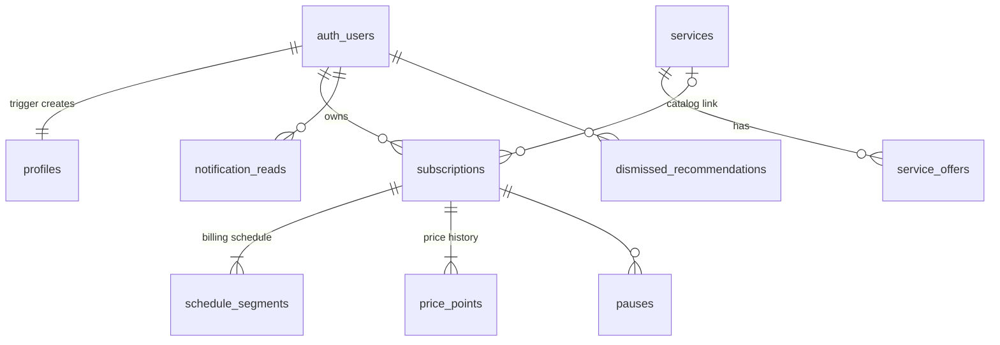

# Subtrack database (Supabase)

Schema, security rules and the server-side API for Subtrack. There is one
shared **dev** project. All changes go through migration files in this folder;
don't change the schema by hand in the dashboard.

## Workflow

```bash
supabase login
supabase link --project-ref <project-ref>        # asks for the database password
supabase migration new <short_name>              # creates supabase/migrations/<timestamp>_<short_name>.sql
supabase db push                                 # applies new migrations to the dev project
npm run db:types                                 # regenerates shared/src/database.types.ts
```

- Never edit a migration that has already been pushed. Write a new one.
- The catalog and demo data come from TypeScript: `npm run gen:sql -- catalog` / `-- demo`
  prints SQL to paste into a new migration after you change `shared/src/catalog.ts` or `seed.ts`.
- Tests (pgTAP) are in `tests/database/`. Each file runs in a transaction that is rolled back:
  `supabase test db --linked`, or `psql "$DB_URL" -f supabase/tests/database/<file>.sql`.

## Data model



| Table | What it holds | Frontend type |
|---|---|---|
| `profiles` | Settings: language, base currency, EUR/USD rates, default reminder, notification channels, student flag, time zone | `Settings` (theme stays in the browser, email is `auth.users.email`) |
| `services`, `service_offers` | Catalog of known services and their plans (default / student / cheaper / annual) | `CatalogService` (read the `catalog_services` view) |
| `subscriptions` | One row per subscription | `Subscription` |
| `schedule_segments` | `{from, start, cycle}`. A new segment starts when the cycle or next date changes | `Subscription.schedule` |
| `price_points` | `{date, amount, is_plan_change}` | `Subscription.priceHistory` |
| `pauses` | `{from, to}`, at most one open pause | `Subscription.pauses` |
| `notification_reads` | Ids of read notifications (e.g. `renewal:<sub id>:2026-11-17`) | `readNotificationIds` |
| `dismissed_recommendations` | Ids of dismissed tips | `dismissedRecIds` |

Charges, statistics, notifications and recommendations are **computed**, not
stored: in TypeScript by `@subtrack/shared`, and in SQL by the billing functions below.

## Security

- Row level security is on for every table. A signed-in user only sees and changes their own rows.
  The catalog is readable by everyone and writable by no one.
- **Always call Supabase with the user's session** (supabase-js does this after sign-in).
  The secret / service_role key bypasses RLS and has no `auth.uid()`, so the user RPCs below
  don't work with it. Keep it for trusted server jobs only, and never put it in the frontend.
- Helper functions live in the `private` schema, which the API does not expose.

## API

All functions take and return the **frontend types as JSON**, so a store action becomes one call.
Pass `p_today` as the user's local date (`toISO(today())`) so "today" matches the UI.

| Store action (`frontend/src/store/store.ts`) | Call |
|---|---|
| load everything | `supabase.rpc('get_subscriptions')` returns `Subscription[]` |
| `addSubscription(input)` | `rpc('create_subscription', { p_input: input, p_today })` returns `Subscription` |
| `updateSubscription(id, input)` | `rpc('update_subscription', { p_id, p_input: input, p_today })` |
| `deleteSubscription(id)` | `rpc('delete_subscription', { p_id })` returns a snapshot for undo |
| `restoreSubscription(snapshot)` | `rpc('restore_subscription', { p_snapshot })` |
| `pause` / `resume` / `cancelSubscription(id)` | `rpc('pause_subscription' \| 'resume_subscription' \| 'cancel_subscription', { p_id, p_today })` |
| `applyRecommendation(rec)` | `cancel_subscription`, or `rpc('switch_plan', { p_id, p_plan, p_price, p_cycle, p_today })` |
| `clearAll()` | `rpc('clear_my_data')` |
| `resetDemo()` | `rpc('seed_demo_data', { p_today })` returns `Subscription[]` |
| import old localStorage / JSON export | `rpc('import_subscriptions', { p_subscriptions })` |
| `markNotificationsRead(ids)` | `from('notification_reads').upsert(ids.map(id => ({ notification_id: id })), { ignoreDuplicates: true })` |
| `dismissRecommendation(id)` / `restoreRecommendations()` | insert into / delete from `dismissed_recommendations` |
| `updateSettings(patch)` | `from('profiles').update({...}).eq('id', userId)` |
| catalog | `from('catalog_services').select()` (also works signed out) |

Sign-up: `supabase.auth.signUp({ email, password, options: { data: { display_name, lang } } })`.
A trigger creates the `profiles` row from that metadata.

### Billing functions (SQL ports of `shared/src/schedule.ts`)

`charge_dates(sub_id, from, to)`, `next_charge(sub_id, today)`, `price_at(sub_id, date)`,
`cycle_at(sub_id, date)`, `current_terms(sub_id, today)`, `effective_status(status, trial_ends_at, today)`,
`convert_amount(amount, from, to, rate_eur, rate_usd)`, `add_cycle(date, cycle, n)`,
`get_charges(from, to)` (every charge of the caller in a range, with amounts converted to the base currency),
and the `price_changes` view (provider price changes).
These must give the same results as the TypeScript code. If you change a billing rule, change both.

## Edge Functions

`functions/<name>/deno.json` maps `@subtrack/shared` to `../../../shared/src/index.ts`, so functions
reuse the same logic as the app (see `functions/shared-import-check`, a throwaway example).
Deploy with `supabase functions deploy <name> --use-api`.
